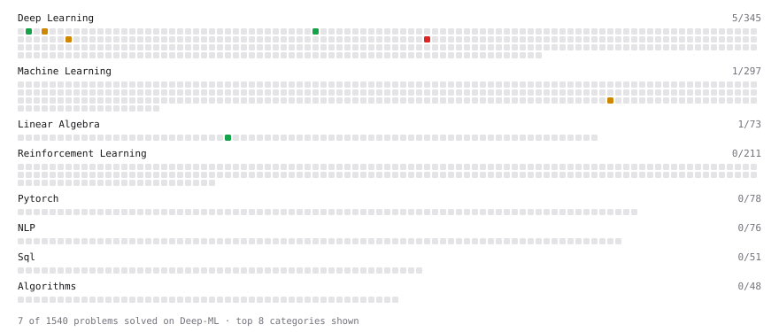

# Deep-ML

My machine learning practice from [Deep-ML](https://www.deep-ml.com). Every solution here was written by hand.

**9** solved · 9 problems · 0 labs · 0 math

[**Browse the interactive portfolio**](https://tralpha.github.io/deep-ml/) to replay this filling in over time.

## Problems

| | Difficulty | Solved | |
| --- | --- | --- | --- |
| [Calculate Cosine Similarity Between Vectors](https://www.deep-ml.com/problems/76) | easy | 2026-10-11 | [solution](problems/0076-calculate-cosine-similarity-between-vectors) |
| [Compute Multi-class Cross-Entropy Loss](https://www.deep-ml.com/problems/134) | easy | 2026-10-08 | [solution](problems/0134-compute-multi-class-cross-entropy-loss) |
| [Softmax Activation Function Implementation ](https://www.deep-ml.com/problems/23) | easy | 2026-10-12 | [solution](problems/0023-softmax-activation-function-implementation) |
| [Adam Optimizer](https://www.deep-ml.com/problems/87) | medium | 2026-10-15 | [solution](problems/0087-adam-optimizer) |
| [Build Scaled Dot-Product Attention](https://www.deep-ml.com/problems/490) | medium | 2026-10-15 | [solution](problems/0490-build-scaled-dot-product-attention) |
| [KV Cache for Efficient Autoregressive Attention](https://www.deep-ml.com/problems/376) | medium | 2026-10-14 | [solution](problems/0376-kv-cache-for-efficient-autoregressive-attention) |
| [Single Neuron with Backpropagation](https://www.deep-ml.com/problems/25) | medium | 2026-10-13 | [solution](problems/0025-single-neuron-with-backpropagation) |
| [Trim Input Tokens to Fit Model Context Window](https://www.deep-ml.com/problems/1036) | medium | 2026-10-12 | [solution](problems/1036-trim-input-tokens-to-fit-model-context-window) |
| [Build a Transformer Encoder Layer](https://www.deep-ml.com/problems/491) | hard | 2026-10-11 | [solution](problems/0491-build-a-transformer-encoder-layer) |

---

_This file is regenerated by Deep-ML on every push._
