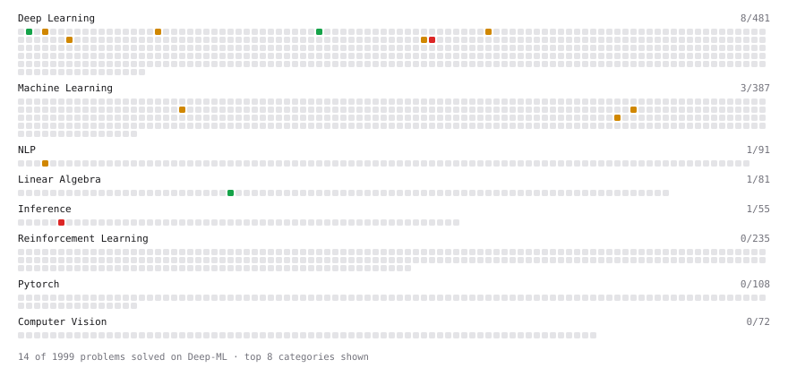

# Deep-ML

My machine learning practice from [Deep-ML](https://www.deep-ml.com). Every solution here was written by hand.

**16** solved · 16 problems · 0 labs · 0 math

[**Browse the interactive portfolio**](https://tralpha.github.io/deep-ml/) to replay this filling in over time.

## Problems

| | Difficulty | Solved | |
| --- | --- | --- | --- |
| [Calculate Cosine Similarity Between Vectors](https://www.deep-ml.com/problems/76) | easy | 2026-10-11 | [solution](problems/0076-calculate-cosine-similarity-between-vectors) |
| [Compute Multi-class Cross-Entropy Loss](https://www.deep-ml.com/problems/134) | easy | 2026-10-08 | [solution](problems/0134-compute-multi-class-cross-entropy-loss) |
| [Softmax Activation Function Implementation ](https://www.deep-ml.com/problems/23) | easy | 2026-10-12 | [solution](problems/0023-softmax-activation-function-implementation) |
| [Adam Optimizer](https://www.deep-ml.com/problems/87) | medium | 2026-10-15 | [solution](problems/0087-adam-optimizer) |
| [Beam Search Decoding](https://www.deep-ml.com/problems/385) | medium | 2026-11-11 | [solution](problems/0385-beam-search-decoding) |
| [BM25 Ranking ](https://www.deep-ml.com/problems/90) | medium | 2026-10-17 | [solution](problems/0090-bm25-ranking) |
| [Build Scaled Dot-Product Attention](https://www.deep-ml.com/problems/490) | medium | 2026-10-15 | [solution](problems/0490-build-scaled-dot-product-attention) |
| [Greedy Semantic Deduplication via Cosine Similarity](https://www.deep-ml.com/problems/775) | medium | 2026-11-12 | [solution](problems/0775-greedy-semantic-deduplication-via-cosine-similarity) |
| [Implement K-Nearest Neighbors](https://www.deep-ml.com/problems/173) | medium | 2026-11-13 | [solution](problems/0173-implement-k-nearest-neighbors) |
| [KV Cache for Efficient Autoregressive Attention](https://www.deep-ml.com/problems/376) | medium | 2026-10-14 | [solution](problems/0376-kv-cache-for-efficient-autoregressive-attention) |
| [LoRA: Low-Rank Adaptation Forward Pass](https://www.deep-ml.com/problems/222) | medium | 2026-11-05 | [solution](problems/0222-lora-low-rank-adaptation-forward-pass) |
| [Single Neuron with Backpropagation](https://www.deep-ml.com/problems/25) | medium | 2026-10-13 | [solution](problems/0025-single-neuron-with-backpropagation) |
| [Trim Input Tokens to Fit Model Context Window](https://www.deep-ml.com/problems/1036) | medium | 2026-10-12 | [solution](problems/1036-trim-input-tokens-to-fit-model-context-window) |
| [Build a Transformer Encoder Layer](https://www.deep-ml.com/problems/491) | hard | 2026-10-11 | [solution](problems/0491-build-a-transformer-encoder-layer) |
| [Combined Token Sampling Pipeline (Temperature + Top-k + Top-p)](https://www.deep-ml.com/problems/419) | hard | 2026-10-20 | [solution](problems/0419-combined-token-sampling-pipeline-temperature-top-k-top-p) |
| [Implement Speculative Decoding Verification](https://www.deep-ml.com/problems/394) | hard | 2026-11-12 | [solution](problems/0394-implement-speculative-decoding-verification) |

---

_This file is regenerated by Deep-ML on every push._
